<picture>
  <source media="(prefers-color-scheme: dark)" srcset="assets/banner-dark.svg">
  <source media="(prefers-color-scheme: light)" srcset="assets/banner-light.svg">
  
</picture>

  
  
  

## Olá, eu sou o Ariel 👋

Sou bacharel em **Tecnologia da Informação** (UNINOVE) e técnico em Informática para Internet (ETEC). Estou fazendo a transição para **Segurança da Informação**, com foco em **SOC e Blue Team**.

Gosto de transformar trabalho manual em sistema. Na Câmara Municipal, por exemplo, criei por conta própria um sistema que gerava ofícios, gráficos e resumos para reuniões. Aqui no GitHub eu documento o que construo e estudo: detecção de ameaças, redes e desenvolvimento seguro.

- 🎯 **Buscando:** primeira oportunidade como Analista SOC / Segurança da Informação Jr.
- 📚 **Estudando agora:** CompTIA Security+ e EC-Council Certified SOC Analyst (CSA)
- 🧪 **Em construção:** um homelab de SOC para praticar detecção e resposta
- 🌎 **Idiomas:** português nativo e **inglês fluente**
- 📍 Poá, São Paulo, Brasil

## Projetos em destaque

<table>
  <tr>
    <td width="50%" valign="top">
      
      <h3><a href="https://github.com/Cipriano2004/security-network-portfolio">🛡️ NetSOC Lab</a></h3>
      
Laboratório de SOC/NOC. Faz o inventário da rede local e gera <b>9 detecções mapeadas no MITRE ATT&amp;CK</b>, como serviços de risco expostos, dispositivos e portas novas e conexões para portas de C2. Também detecta <b>anomalias no host com Isolation Forest</b> e grava os eventos em JSONL, prontos para Wazuh/Splunk.

      
      
      
      
    </td>
    <td width="50%" valign="top">
      
      <h3><a href="https://github.com/Cipriano2004/gestao-oficios">📄 Gestão de Ofícios</a></h3>
      
Sistema web que automatiza a criação, a numeração e o acompanhamento de ofícios de um gabinete legislativo. Tem <b>login com perfis, proteção CSRF, limite de tentativas, CSP e trilha de auditoria</b>, além de numeração transacional testada com usuários simultâneos.

      
      
      
      
    </td>
  </tr>
</table>

## Habilidades

**Segurança**
 

**Ferramentas**
 

**Redes e sistemas**
 

**Desenvolvimento**
 

## Certificações

| Certificação | Emissor | Ano |
|---|---|---|
| Cyber Threat Management | Cisco Networking Academy | 2025 |
| Cybersecurity | FIAP | 2025 |
| Multicloud Network Associate | Aviatrix | 2025 |
| Introduction to Critical Infrastructure Protection (ICIP) | OPSWAT Academy | 2025 |
| CompTIA Security+ | CompTIA | *em preparação* |
| Certified SOC Analyst (CSA) | EC-Council | *em preparação* |

<b>🇺🇸 In English</b>

 

I hold a Bachelor's degree in Information Technology and I'm moving into **Information Security**, focused on **SOC / Blue Team** work. I build hands-on projects to practice it:

- **NetSOC Lab**: network inventory with 9 MITRE ATT&CK–mapped detections, host anomaly detection with Isolation Forest, and SIEM-ready JSON events.
- **Gestão de Ofícios**: a document-automation web app with role-based access, CSRF protection, rate limiting, CSP and an audit trail.

I'm fluent in English and currently studying for CompTIA Security+ and EC-Council CSA. I'm open to **Junior SOC Analyst** roles, on-site, hybrid or remote.

---

Projetos de segurança aqui são executados apenas em ambientes próprios ou autorizados.

